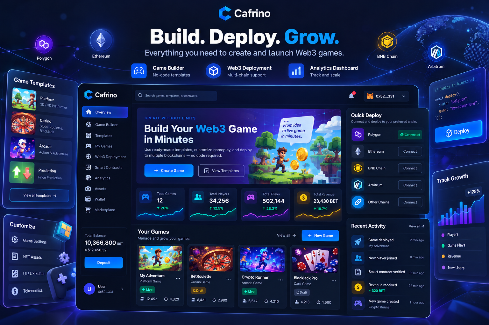
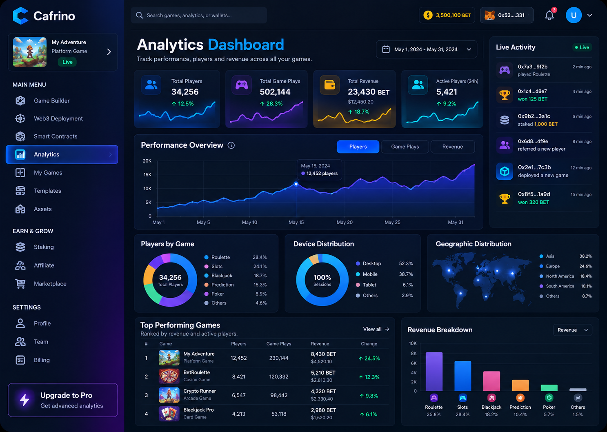
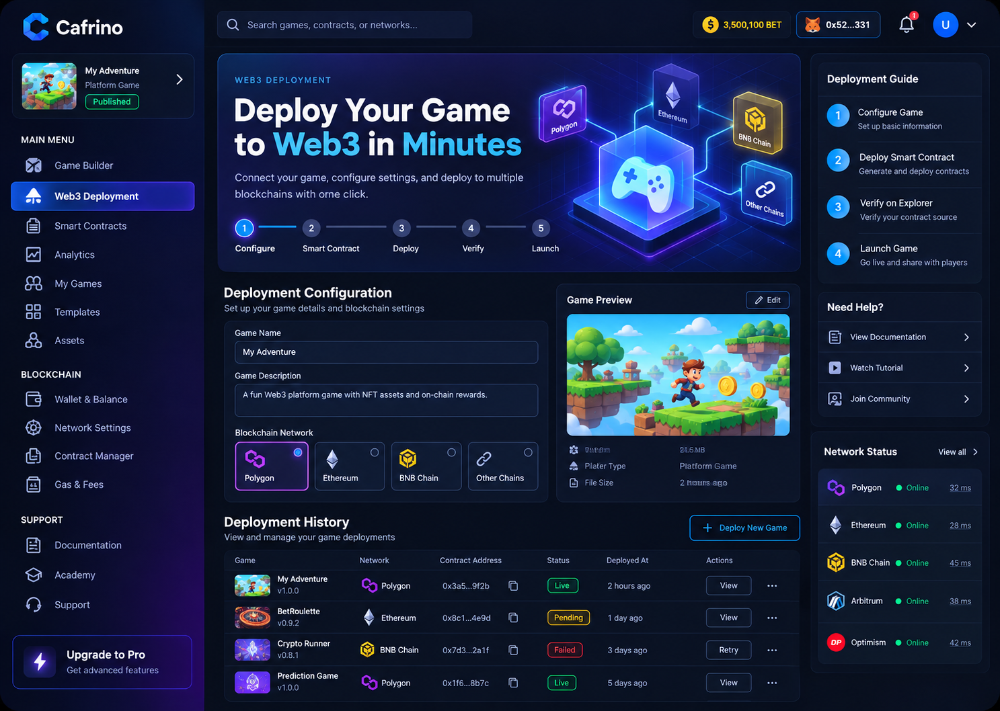
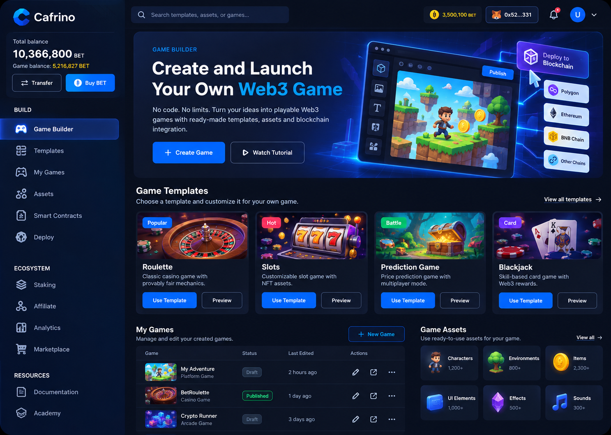

# Cafrino


**Decentralized Web3 Gaming Infrastructure** — a next-generation blockchain platform focused on empowering developers to build scalable, secure, and innovative decentralized gaming applications.



---

## How it works

Cafrino simplifies Web3 game creation through one seamless workflow:

**Choose  → Build  → Launch  → Grow**

1. **Choose** — Start with ready-to-use game templates or create a custom gaming experience.
2. **Build** — Customize game features, design, and functionality through an intuitive, no-code interface.
3. **Launch** — Publish your game using integrated Web3 infrastructure and blockchain connectivity.
4. **Grow** — Manage your games, track performance, and expand your audience through a unified dashboard.

Architecture today: React + Vite frontend with an Express API. Demo mode uses mock data — **MongoDB is optional**.

---

| Game Builder | Web3 Deployment | Analytics Dashboard |
|:-----:|:--------------:|:-----------------:|
|  |  |  |

---

## Requirements

- **Node.js 18+** ([nodejs.org](https://nodejs.org/))
- npm (comes with Node)

---

## Getting started

```bash
# 1. Install Backend dependencies
npm install

# 2. Install Frontend dependencies
cd client
npm install
cd ..

# 3. Launch Project
npm start
```

Then open: **http://127.0.0.1:5173/**

| Service  | URL |
|----------|-----|
| Frontend | http://127.0.0.1:5173/ |
| API      | http://127.0.0.1:9030/ |

---

## Stack

| Layer | Tech |
|-------|------|
| Frontend | React 18, Vite, React Router, Bootstrap 5 |
| Backend | Node.js, Express |

---

Copyright © 2025 GameFi
